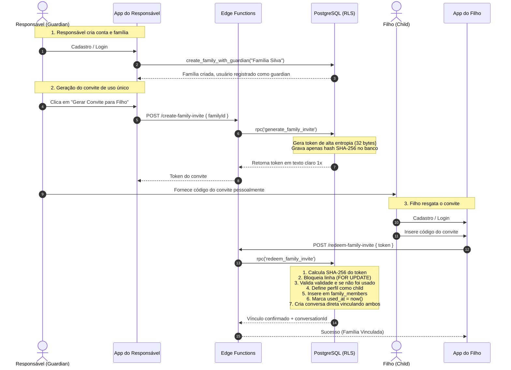
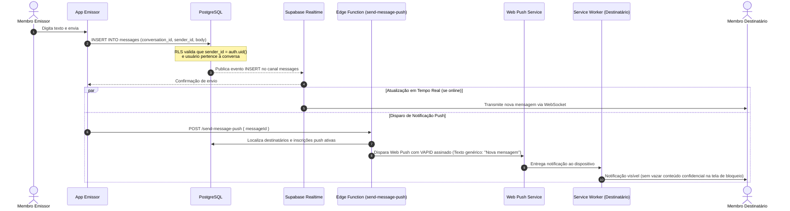

# Arquitetura e Fluxos do Sistema

Este documento descreve a topologia, os componentes e os diagramas de fluxo do backend para a comunicação familiar privada.

---

## 1. Visão Geral da Arquitetura

O sistema é baseado em uma arquitetura privada e isolada, construída com:
- **Supabase Auth**: Gerenciamento de credenciais e emissão de JWTs assinados.
- **PostgreSQL com RLS Estrito**: Isolamento total de tenant (família). Apenas membros ativos da mesma família autorizados podem consultar registros.
- **Supabase Realtime**: Notificação de novas mensagens e troca de sinais efêmeros WebRTC via publicação/assinatura segura.
- **Edge Functions (Deno runtime)**: Endpoints atômicos e protegidos para operações que exigem integridade transacional (ex: criação e resgate de convites, push notifications, emissão de credenciais TURN).
- **WebRTC Peer-to-Peer**: Transporte de áudio e vídeo de ponta a ponta criptografado (DTLS-SRTP). Nenhuma mídia passa ou é armazenada no Supabase.

```mermaid
flowchart TD
    subgraph DispositivoResponsavel["Dispositivo Responsável (Guardian)"]
        UI_G["React Frontend PWA"]
        RTC_G["WebRTC PeerConnection"]
        SW_G["Service Worker (Push)"]
    end

    subgraph DispositivoFilho["Dispositivo Filho (Child)"]
        UI_C["React Frontend PWA"]
        RTC_C["WebRTC PeerConnection"]
        SW_C["Service Worker (Push)"]
    end

    subgraph SupabaseCloud["Supabase Backend"]
        Auth["Supabase Auth"]
        DB[("PostgreSQL (RLS Habilitado)")]
        RT["Supabase Realtime Engine"]
        EF["Edge Functions (Deno)"]
    end

    subgraph InfraestruturaWebRTC["Infraestrutura WebRTC"]
        STUN["Servidores STUN (Google / Público)"]
        TURN["Servidor TURN (Coturn / Provedor Gerenciado)"]
    end

    subgraph ProvedoresPush["Notificações Push"]
        WebPush["Web Push Gateway (FCM/Apple/Mozilla)"]
    end

    UI_G -->|Auth / Login| Auth
    UI_C -->|Auth / Login| Auth
    UI_G -->|Consultas com RLS| DB
    UI_C -->|Consultas com RLS| DB
    UI_G <-->|Subscrição Realtime| RT
    UI_C <-->|Subscrição Realtime| RT
    UI_G -->|Ações Protegidas| EF
    UI_C -->|Ações Protegidas| EF

    EF -->|Disparo VAPID| WebPush
    WebPush -->|Entrega Push| SW_G
    WebPush -->|Entrega Push| SW_C

    RTC_G <-->|Sinalização SDP/ICE via Realtime| RTC_C
    RTC_G <-->|Mídia Direta DTLS-SRTP (P2P)| RTC_C
    RTC_G -.->|Relay de Mídia em Redes Restritas| TURN
    RTC_C -.->|Relay de Mídia em Redes Restritas| TURN
```

---

## 2. Fluxo de Autenticação e Vínculo Familiar



---

## 3. Fluxo de Mensagens em Tempo Real e Push



---

## 4. Fluxo de Chamadas WebRTC e Sinalização

```mermaid
sequenceDiagram
    autonumber
    actor Chamador as Responsável / Filho
    participant App_A as Dispositivo Chamador
    participant EF as Edge Functions
    participant DB as Supabase DB / Realtime
    participant App_B as Dispositivo Chamado
    actor Chamado as Destinatário

    Chamador->>App_A: Clica em "Ligar (Voz ou Vídeo)"
    App_A->>EF: POST /create-call { conversationId, callType }
    EF->>DB: Cria registro em 'calls' (status: ringing)
    EF-->>App_A: Retorna callId

    par Notificação do Destinatário
        EF->>App_B: Dispara Push "Chamada recebida"
    and Sinalização Realtime
        DB->>App_B: Evento INSERT na tabela calls via Realtime
    end

    App_B->>Chamado: Toca aviso de chamada recebida com opções Atender/Recusar

    alt Chamado Atende
        Chamado->>App_B: Clica em "Atender"
        App_B->>EF: POST /get-turn-credentials
        EF-->>App_B: Retorna servidores STUN/TURN com credenciais temporárias
        App_A->>EF: POST /get-turn-credentials
        EF-->>App_A: Retorna servidores STUN/TURN com credenciais temporárias

        App_B->>EF: POST /update-call-status { callId, status: 'accepted' }

        Note over App_A,App_B: Troca de SDP Offer / Answer via call_signals
        App_A->>DB: INSERT INTO call_signals (type: 'offer', payload: sdp)
        DB->>App_B: Entrega Offer via Realtime
        App_B->>DB: INSERT INTO call_signals (type: 'answer', payload: sdp)
        DB->>App_A: Entrega Answer via Realtime

        Note over App_A,App_B: Troca de ICE Candidates via call_signals
        App_A<->App_B: Negociação de conectividade direta P2P (ou via TURN se restrito)

        Note over App_A,App_B: Conversa de áudio/vídeo em andamento (DTLS-SRTP Criptografada)
    else Chamado Recusa ou Desliga
        Chamado->>App_B: Clica em "Recusar" ou "Encerrar"
        App_B->>EF: POST /update-call-status { callId, status: 'rejected' ou 'ended' }
        DB->>App_A: Notifica encerramento via Realtime
        Note over App_A,App_B: Câmera e microfone são imediatamente liberados
    end
```

